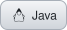
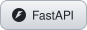

# Luis Marco

  
  

Passionate about technology and process optimization, 
with a strong focus on problem-solving, agile methodologies, and collaborative teamwork.

<b>SOFT SKILLS</b> 

 

### Stack

<b>MOBILE</b> 

<b>WEB</b> 

<b>WEB FRAMEWORKS</b> 

<b>CSS FRAMEWORKS</b> 

<b>UI LIBRARIES</b> 

<b>BACKEND</b> 

<b>BACKEND FRAMEWORKS</b> 

<b>DATABASES</b> 

<b>TOOLS</b> 

