##  Hey there! I'm Luis Marco

<table>
  <tr>
    <td width="200" align="center" valign="middle">
      
    </td>
    <td valign="middle">
      Passionate about technology and process optimization, with a strong focus on problem-solving, agile methodologies, and collaborative teamwork.
    </td>
  </tr>
</table>

  

##  What I Do

<table>
  <tr>
    <td width="33%" align="center" valign="top">
       
      
      <h3>Mobile</h3>
      Cross-platform and native apps with Flutter &amp; Kotlin.
        
    </td>
    <td width="33%" align="center" valign="top">
       
      
      <h3>Web</h3>
      Modern, responsive interfaces with React &amp; Angular.
        
    </td>
    <td width="33%" align="center" valign="top">
       
      
      <h3>Backend</h3>
      APIs and services with Spring, Laravel, Flask &amp; FastAPI.
        
    </td>
  </tr>
</table>

##  Tech Stack

<table>
  <tr>
    <td width="210"> <b>Mobile</b></td>
    <td>
      
      
    </td>
  </tr>
  <tr>
    <td> <b>Web</b></td>
    <td>
      
      
      
      
      
      
      
      
    </td>
  </tr>
  <tr>
    <td> <b>Web Frameworks</b></td>
    <td>
      
      
    </td>
  </tr>
  <tr>
    <td> <b>Backend</b></td>
    <td>
      
      
      
      
      
    </td>
  </tr>
  <tr>
    <td> <b>Backend Frameworks</b></td>
    <td>
      
      
      
      
    </td>
  </tr>
  <tr>
    <td> <b>Databases</b></td>
    <td>
      
      
      
      
    </td>
  </tr>
  <tr>
    <td> <b>Tools</b></td>
    <td>
      
      
      
      
    </td>
  </tr>
</table>

 

  

